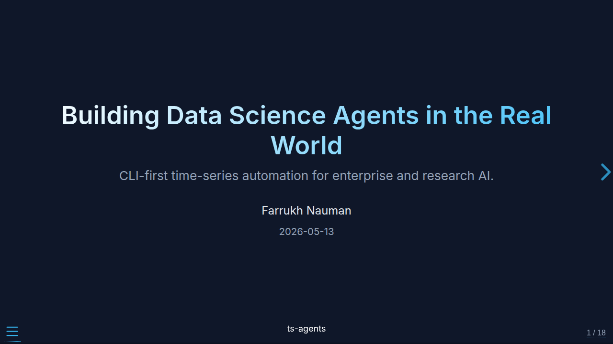
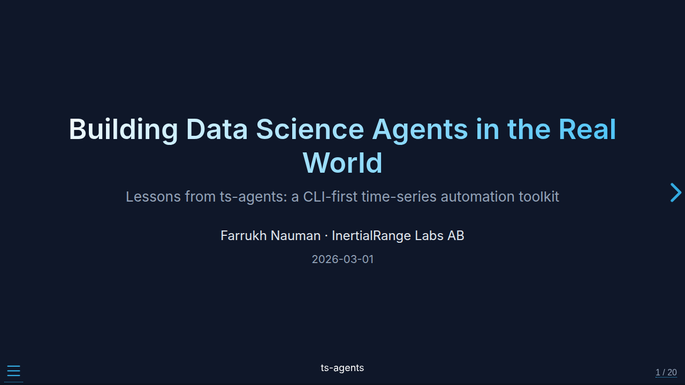

`ts-agents` is a general-purpose, CLI-first time-series toolkit for external
agents and automation. Agents discover methods, run analyses on their own data
files, and get inspectable artifacts with explicit quality signals across task
families:

| Task family | Start with |
| --- | --- |
| First look, data quality, periodicity | `workflow run inspect-series` |
| Anomalies and unusual events | `tool run find_discords --input ...` |
| Change-points and regimes | `tool run segment_changepoint --input ...` |
| Spectra, frequencies, coherence | `tool run compute_psd --input ... --time-col t` |
| Trend and seasonality | `tool run stl_decompose --input ...` |
| Activity recognition | `workflow run activity-recognition` |
| Classification | `tool run compare_classifiers` |
| Forecasting | `workflow run forecast-series` / `forecast-panel` |

Project-specific preparation, custom evaluation, and comprehensive reporting
can still require code. These docs capture the project's durable design
choices so interfaces can evolve without rewriting the core toolchain.

## Why Autonomous Agents Like It

- **Bootstrap with one call:** `ts-agents capabilities --json` returns the full
  agent-facing bootstrap surface (workflows, tools, sandboxes, `install_profile`,
  status-contract guidance).
- **Find tools by task:** `tool search anomaly --json` matches task words and
  synonyms, and every tool takes data with `tool run <tool> --input <file>`.
- **Discover before acting:** `workflow show --json` / `tool show --json`
  expose `cli_templates`, `source_options`, `global_options`,
  `default_output_behavior`, required extras, and availability in the current
  environment.
- **Strict machine envelopes:** every `--json` response carries
  `schema_version: "1.0"`, strict JSON (no raw `NaN`), and typed exit codes for
  validation / dependency / permission / timeout failures.
- **Quality signals:** workflow payloads expose `result.status`
  (`ok` / `degraded`) and `result.data.quality_flags`, while the CLI envelope exposes top-level
  `quality_status`, `degraded`, and `requires_review`.
- **Run lifecycle metadata:** generated run IDs, `run_manifest.json`, and
  non-clobbering default output directories with `--overwrite` / `--resume`
  semantics — so long multi-turn sessions remain traceable and safe to rerun.
- **Sandbox parity + explicit fallback:** `local`, `subprocess`, `docker`,
  `daytona`, and `modal` all stage workflow artifacts back to the host output
  directory; `sandbox doctor` probes readiness; the executor never silently
  downgrades isolation.

## Get Started

1. [Quickstart](quickstart.qmd) — install and run your first workflow in under a minute
2. [CLI Examples](cli-examples.qmd) — the CLI contract by example, across task families
3. [Walkthroughs](walkthroughs.qmd) — step-by-step guides for the first-class workflows
4. [Skills Guide](skills-guide.qmd) — task-family skills for external agents
5. [Panel and foundation-model forecasting](panel-forecasting.qmd) — global GBM/NHITS models and Darts zero-shot checkpoints on long-format panels

## Learn More

- [Evaluation](evaluation.qmd) — benchmark evidence and rerun instructions
- [Design](philosophy.qmd) — why the project is structured around a stable CLI contract for agents
- [Distribution](distribution.qmd) — packaging, release, and publishing workflow

---

## Talks

  <a class="talk-card talk-card-primary" href="talks/ts_agents_enterprise_talk.qmd">
    
    
      Enterprise and research talk
      Building Data Science Agents in the Real World
      CLI-first time-series automation, skills, reports, personalized agents, and autoresearch.
    
  </a>

  <a class="talk-card" href="talks/ts_agents_talk.qmd">
    
    
      Historical design talk (pre-0.4)
      CLI-first Time-Series Automation
      The original architecture, including UI and built-in agents removed in 0.4.0; use the guides for current commands.
    
  </a>

